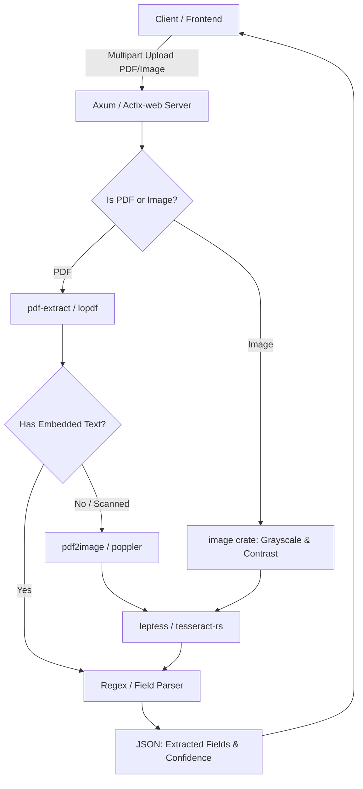

# Rust Backend Document Scanner — Implementation Plan

This document outlines the end-to-end plan to build a high-performance backend service in **Rust** for extracting text and structured data from PDFs and images (Delivery Challans, Invoices, Receipts, etc.).

---

## 1. Architecture Overview



### Key Workflow
1. **Endpoint `POST /api/documents/scan`:** Receives the raw file (PDF, PNG, JPG) via multipart form upload.
2. **Format Detection:** Inspects file MIME type and magic bytes.
3. **Hybrid Extraction Pipeline:**
   - **Digital PDFs:** Extracts text instantly via native PDF parser (`pdf-extract` or `lopdf`).
   - **Scanned PDFs & Images:** Pre-processes image (contrast/rescaling) and routes to native Tesseract OCR bindings (`leptess` or `tesseract`).
4. **Field Mapping Engine:** Applies compiled regex patterns and heuristic table extractors to identify document number, date, party, line items, and totals.
5. **Response:** Returns structured JSON with fields, raw text, and confidence ratings.

---

## 2. Recommended Technology Stack & Crates

| Component | Recommended Crate | Purpose |
| :--- | :--- | :--- |
| **Web Framework** | `axum` (v0.8) | Modern, ergonomic, built on `tokio` and `tower` |
| **Async Runtime** | `tokio` (full) | Multi-threaded async engine |
| **Multipart Upload** | `axum::extract::Multipart` | Streaming file uploads with memory limits |
| **OCR Engine** | `leptess` or `tesseract` | Native bindings to C++ Tesseract & Leptonica |
| **PDF Extraction** | `pdf-extract` / `lopdf` | Direct extraction of text streams from vector PDFs |
| **PDF to Image (Fallback)** | `pdfium-render` / `poppler` | Render scanned PDF pages to images for OCR |
| **Image Preprocessing** | `image` (v0.25) | Fast scaling, grayscale, contrast adjustment |
| **Data Serialization** | `serde`, `serde_json` | JSON serialization/deserialization |
| **Regex & Pattern Matching** | `regex` (with `once_cell` / `lazy_static`) | High-speed regex parsing compiled once |

---

## 3. Project Directory Structure

```text
rust-document-scanner/
├── Cargo.toml
├── Dockerfile
├── tessdata/               # Local training data (eng.traineddata)
│   └── eng.traineddata
└── src/
    ├── main.rs             # Application entrypoint & Axum router
    ├── config.rs           # Environment variables (port, limits)
    ├── error.rs            # Custom error types (AppError)
    ├── models/             # Data structures
    │   ├── mod.rs
    │   └── document.rs     # ExtractedFields, LineItem, etc.
    ├── services/           # Core business logic
    │   ├── mod.rs
    │   ├── pdf.rs          # PDF text extraction & page rasterization
    │   ├── ocr.rs          # Tesseract OCR engine wrapper
    │   ├── preprocessor.rs # Image normalization (grayscale, DPI, contrast)
    │   └── parser.rs       # Regex & field heuristic mapping
    └── routes/             # HTTP Route Handlers
        ├── mod.rs
        └── scan.rs         # File upload & scan endpoint
```

---

## 4. Step-by-Step Implementation Phases

### Phase 1: Environment & System Dependencies
Tesseract requires native C/C++ libraries. Install them on the host or in Docker:
```bash
# Ubuntu / Debian
sudo apt-get update && sudo apt-get install -y \
    clang \
    libclang-dev \
    libleptonica-dev \
    libtesseract-dev \
    tesseract-ocr \
    tesseract-ocr-eng \
    pkg-config
```

### Phase 2: Cargo Dependencies Setup (`Cargo.toml`)
```toml
[package]
name = "rust-document-scanner"
version = "0.1.0"
edition = "2021"

[dependencies]
axum = { version = "0.8", features = ["multipart"] }
tokio = { version = "1.0", features = ["full"] }
serde = { version = "1.0", features = ["derive"] }
serde_json = "1.0"
regex = "1.10"
once_cell = "1.19"
image = "0.25"
leptess = "0.14"        # Or `tesseract = "0.14"`
pdf-extract = "0.7"
tracing = "0.1"
tracing-subscriber = "0.3"
tower-http = { version = "0.6", features = ["cors", "trace"] }
```

### Phase 3: Core Service Modules

#### 1. OCR Service (`src/services/ocr.rs`)
```rust
use leptess::{LepTess, Variable};
use std::path::Path;

pub struct OcrEngine {
    tessdata_path: Option<String>,
}

impl OcrEngine {
    pub fn new(tessdata_path: Option<String>) -> Self {
        Self { tessdata_path }
    }

    pub fn scan_image(&self, image_bytes: &[u8]) -> Result<(String, i32), Box<dyn std::error::Error + Send + Sync>> {
        let tessdata = self.tessdata_path.as_deref();
        let mut lt = LepTess::new(tessdata, "eng")?;
        
        // Optimize for block text (like documents/invoices)
        lt.set_variable(Variable::UserDefinedDpi, "300")?;
        lt.set_image_from_mem(image_bytes)?;
        
        let text = lt.get_utf8_text()?;
        let confidence = lt.mean_text_conf();
        
        Ok((text, confidence))
    }
}
```

#### 2. PDF Direct Extractor (`src/services/pdf.rs`)
```rust
pub fn extract_pdf_text(pdf_bytes: &[u8]) -> Result<String, Box<dyn std::error::Error + Send + Sync>> {
    let text = pdf_extract::extract_text_from_mem(pdf_bytes)?;
    Ok(text)
}
```

#### 3. Structured Data Parser (`src/services/parser.rs`)
Port the heuristic extraction logic from JavaScript into compiled Rust regular expressions:
```rust
use regex::Regex;
use once_cell::sync::Lazy;
use crate::models::document::{ExtractedFields, LineItem};

static VOUCHER_RE: Lazy<Regex> = Lazy::new(|| {
    Regex::new(r"(?i)(?:challan\s*(?:no\.?|#)|voucher\s*(?:no\.?|#)|inv(?:oice)?\s*(?:no\.?|#))\s*[:\-]?\s*([A-Za-z0-9/\-]+)").unwrap()
});

static DATE_RE: Lazy<Regex> = Lazy::new(|| {
    Regex::new(r"(?i)(?:date)\s*[:\-]?\s*(\d{1,2}[\/\-\.]\d{1,2}[\/\-\.]\d{2,4})").unwrap()
});

static TOTAL_RE: Lazy<Regex> = Lazy::new(|| {
    Regex::new(r"(?i)(?:grand\s+total|total\s+amount|net\s+amount)\s*[:\-]?\s*(?:rs\.?|inr)?\s*([0-9,]+(?:\.[0-9]{2})?)").unwrap()
});

pub fn parse_extracted_text(text: &str) -> ExtractedFields {
    let mut fields = ExtractedFields::default();
    
    if let Some(caps) = VOUCHER_RE.captures(text) {
        fields.voucher_no = caps.get(1).map_or(String::new(), |m| m.as_str().to_string());
    }
    
    if let Some(caps) = DATE_RE.captures(text) {
        fields.date = caps.get(1).map_or(String::new(), |m| m.as_str().to_string());
    }
    
    if let Some(caps) = TOTAL_RE.captures(text) {
        fields.total_amount = caps.get(1).map_or(String::new(), |m| m.as_str().replace(',', ""));
    }
    
    // Add additional table & item line heuristics here
    fields
}
```

#### 4. Axum HTTP Handler (`src/routes/scan.rs`)
```rust
use axum::{
    extract::Multipart,
    response::Json,
    http::StatusCode,
};
use serde_json::{json, Value};
use crate::services::{ocr::OcrEngine, pdf, parser};

pub async fn scan_document(
    mut multipart: Multipart,
) -> Result<Json<Value>, (StatusCode, String)> {
    let mut file_bytes: Option<Vec<u8>> = None;
    let mut file_name = String::new();

    while let Some(field) = multipart.next_field().await.map_err(|e| (StatusCode::BAD_REQUEST, e.to_string()))? {
        if field.name() == Some("file") {
            file_name = field.file_name().unwrap_or("document").to_string();
            let data = field.bytes().await.map_err(|e| (StatusCode::BAD_REQUEST, e.to_string()))?;
            file_bytes = Some(data.to_vec());
            break;
        }
    }

    let bytes = file_bytes.ok_or((StatusCode::BAD_REQUEST, "No file uploaded".to_string()))?;
    let is_pdf = file_name.to_lowercase().ends_with(".pdf");

    // Hybrid processing:
    let (raw_text, confidence) = if is_pdf {
        match pdf::extract_pdf_text(&bytes) {
            Ok(txt) if txt.trim().len() > 30 => (txt, 100),
            _ => {
                // Fallback to OCR if digital text is empty (scanned PDF)
                // (requires rasterization or image conversion)
                ("Scanned PDF needs rasterization".to_string(), 0)
            }
        }
    } else {
        let ocr = OcrEngine::new(None);
        ocr.scan_image(&bytes).map_err(|e| (StatusCode::INTERNAL_SERVER_ERROR, e.to_string()))?
    };

    let fields = parser::parse_extracted_text(&raw_text);

    Ok(Json(json!({
        "success": true,
        "fields": fields,
        "raw_text": raw_text,
        "confidence": confidence
    })))
}
```

---

## 5. Production Dockerfile

Using a multi-stage Docker build produces a lean, secure, and production-ready image:

```dockerfile
# --- Stage 1: Build binary ---
FROM rust:1.82-bookworm AS builder

# Install Tesseract development headers
RUN apt-get update && apt-get install -y \
    clang \
    libclang-dev \
    libleptonica-dev \
    libtesseract-dev \
    pkg-config

WORKDIR /app
COPY Cargo.toml Cargo.lock ./
COPY src ./src

RUN cargo build --release

# --- Stage 2: Runtime Image ---
FROM debian:bookworm-slim AS runtime

RUN apt-get update && apt-get install -y \
    libtesseract5 \
    liblept5 \
    tesseract-ocr-eng \
    ca-certificates \
    && rm -rf /var/lib/apt/lists/*

WORKDIR /app
COPY --from=builder /app/target/release/rust-document-scanner /app/rust-document-scanner

ENV RUST_LOG=info
EXPOSE 8080

CMD ["/app/rust-document-scanner"]
```

---

## 6. Comparison: Rust Backend vs JavaScript Frontend

| Metric | JavaScript (Frontend Browser) | Rust (Dedicated Backend) |
| :--- | :--- | :--- |
| **Execution Speed** | 3 – 8 seconds per page | **200 – 800 ms per page** |
| **Memory Footprint** | ~300 MB browser tab RAM | **~25 – 60 MB server RAM** |
| **CPU Utilization** | Single-threaded Web Worker | Multi-core SIMD native parallelism |
| **Model Distribution** | Downloads ~20MB traineddata via CDN | Pre-baked in Docker container (0 client download) |
| **Client Devices** | Struggles on budget phones / older tabs | Runs smoothly regardless of client device |
